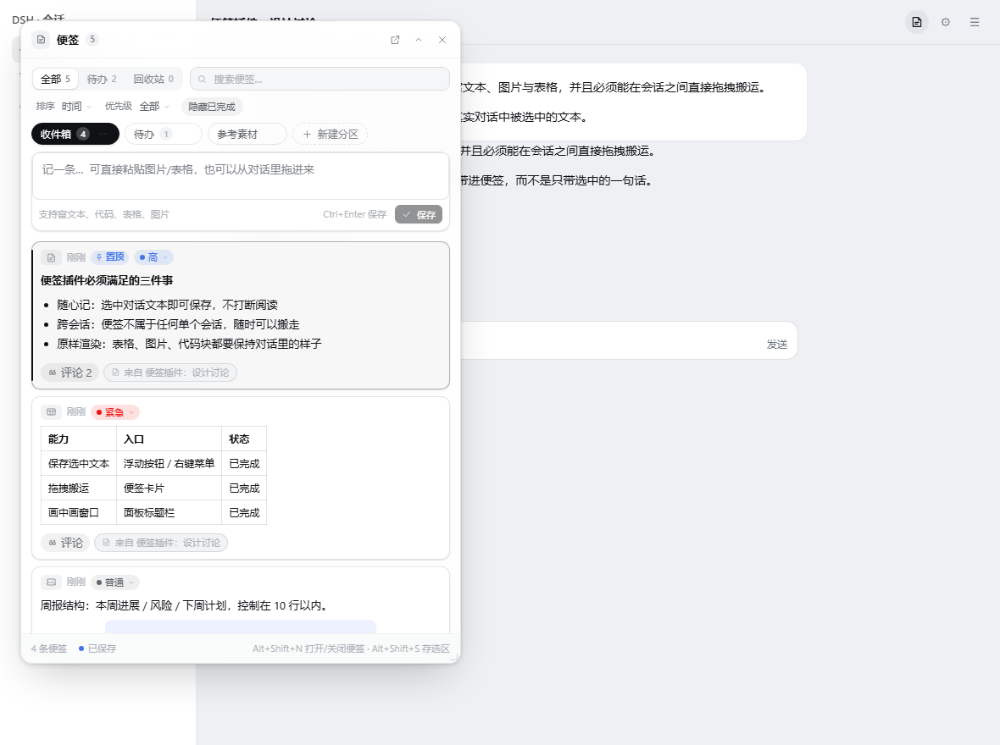
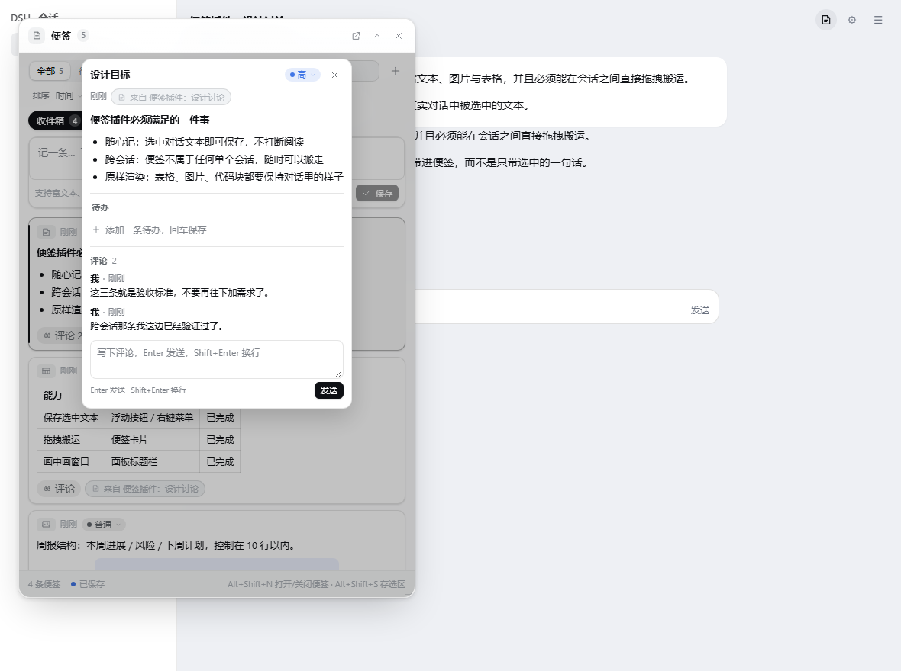
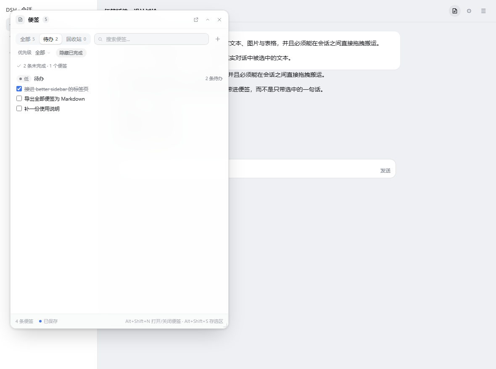
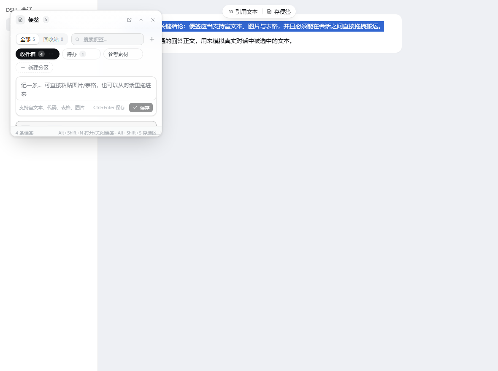
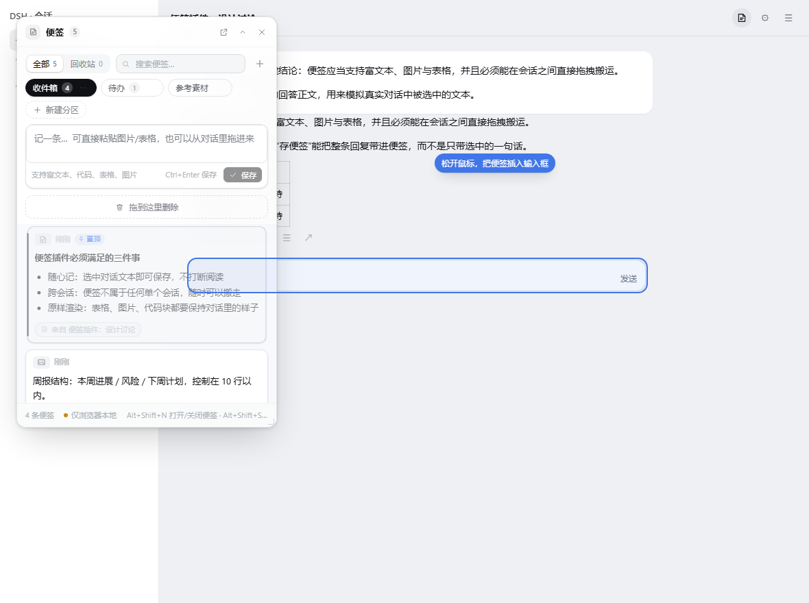
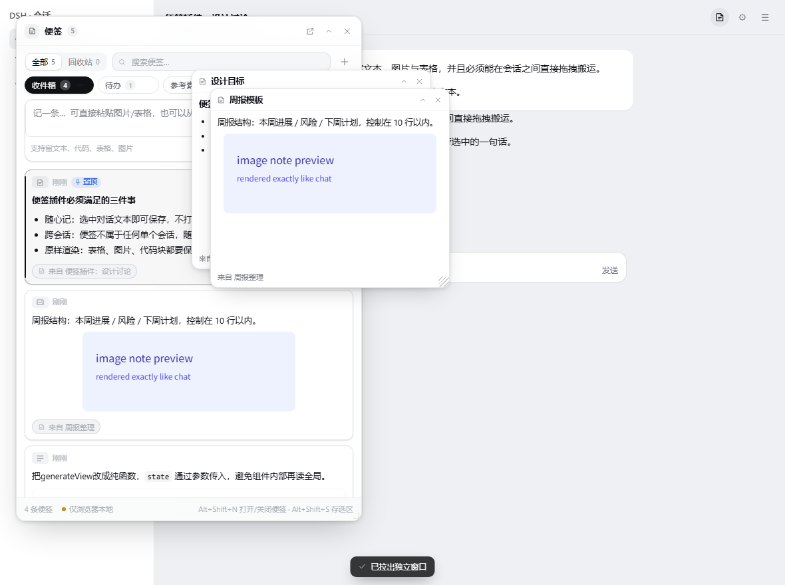
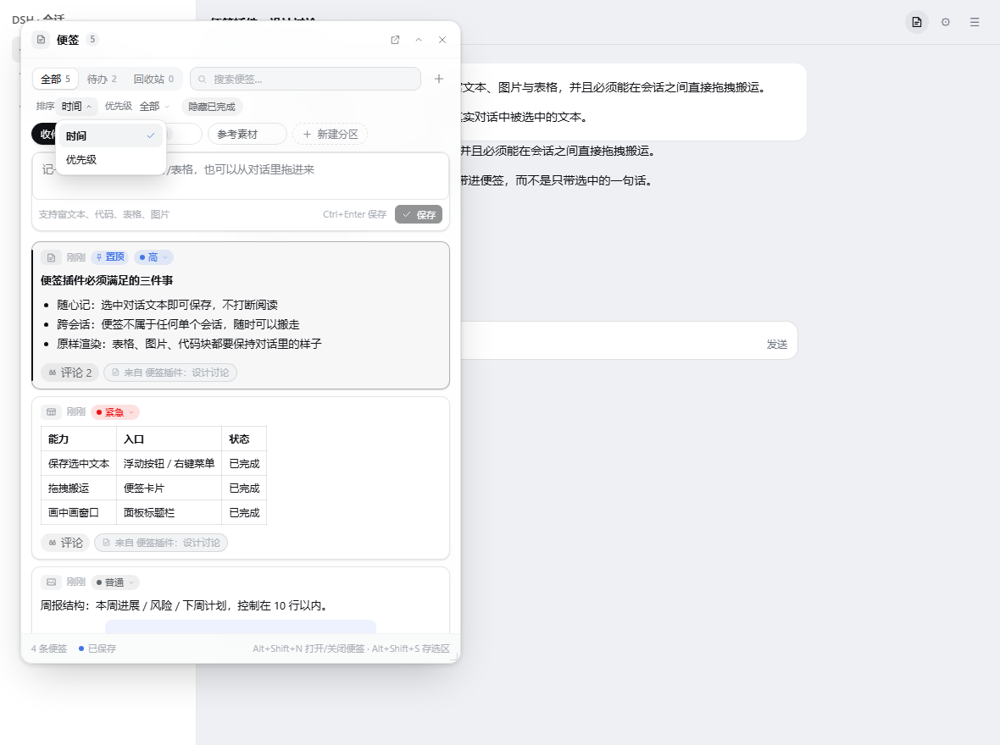
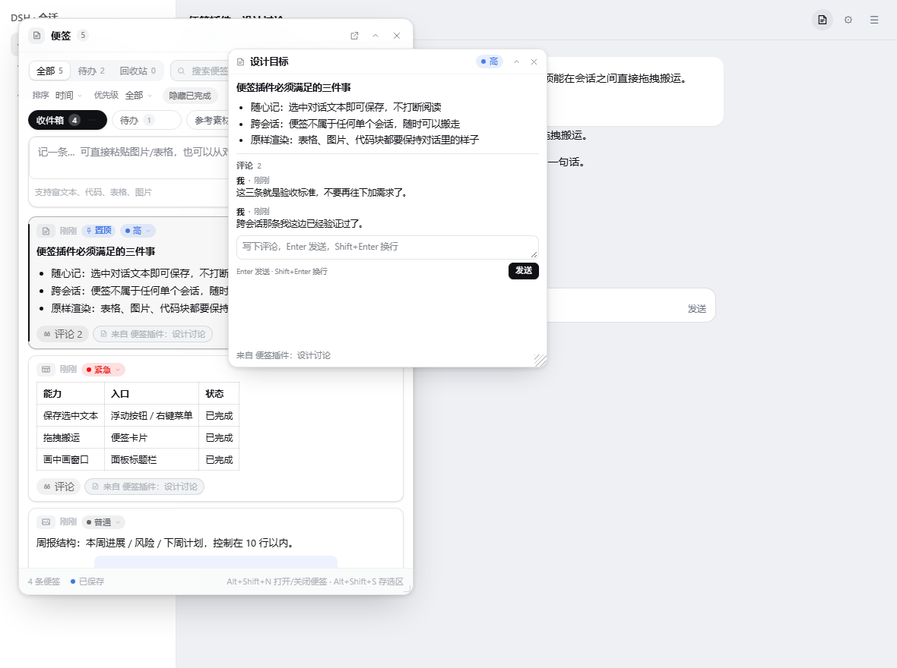

# dsh-sticky-board · DSH 便签

[English](./README.en.md)

DSH Web UI 的便签插件：**随手记**下对话里的内容，**跨会话搬运**，分区管理，表格 / 图片 / 代码原样保留，带**优先级**、**待办清单**与**便签评论**，还能放进**置顶画中画窗口**里跨应用使用。



| 便签详情与评论 | 待办总览 |
| --- | --- |
|  |  |

| 选中对话文本 | 拖进输入框 | 拖出独立窗口 |
| --- | --- | --- |
|  |  |  |

| 主题化下拉菜单 | 独立窗口里也能评论 |
| --- | --- |
|  |  |

更多截图：`assets/`（`screenshots.json` 是插件市场的截图清单）。

## 功能

- **从对话里存便签**：在消息里选中文本，选区上方浮出的菜单里同时有 **「引用文本」** 和 **「存便签」** 两个动作（原来的引用文本没有被替换掉，只是多了一个入口）；右键菜单里也有同一入口；`Alt+Shift+S` 直接保存当前选区。
- **对话之外也能存**：在工具输出、文件预览等聊天流不接管选区的地方，同一个「存便签」小浮标会跟在选区右下角出现。
- **富内容**：存下来的是渲染后的 HTML —— 表格、图片、代码块、引用、列表都与对话里一致；粘贴图片、拖入表格同样可以。
- **回复一键存便签**：助手回复底部那排图标（复制 / 👍 / 👎 …）里多了一个便签按钮，点一下把**整条回复**（含表格、代码、列表）存进便签，而不是只存选中的一两句。
- **图片右键存便签**：在对话里渲染出来的图片上右键，菜单里除了「复制图片 / 下载 / 在文件夹中显示」，还多一项「存入便签」——图片按 data URL 存进便签，刷新页面后依然在。
- **面板随手记**：会话标题栏右上角的便签图标（**在这一排按钮的最左边**，其它插件的按钮在它右边）打开悬浮面板，直接写、直接存；也支持 `Alt+Shift+N`。
- **分区**：收件箱 + 自定义分区，便签可在分区之间拖动归档，也可拖动排序、拖进回收站。
- **优先级**：每张便签卡片头部有一个优先级胶囊（紧急 / 高 / 普通 / 低，默认「普通」），点一下弹出一列选项即可改；卡片顶部按颜色区分（红 / 蓝 / 灰 / 浅灰），工具栏可按优先级筛选，排序也可从「时间」切成「优先级」，默认仍是时间排序。
- **主题化下拉菜单**：排序、优先级筛选、卡片上的优先级选择都用与面板同一套设计 token 的下拉菜单（浮层挂到 `body`，不会被面板裁切；支持 ↑ / ↓ / Enter / Esc 与外部点击关闭），不再是系统原生的 `select`。
- **待办清单**：每张便签都能加勾选项（回车连续添加、点勾完成、右上角一键清空已完成）。面板顶部的「待办」标签页把所有便签里的待办聚合在一起，按优先级分组、按所属便签聚合，还能搜索与「隐藏已完成」。
- **便签评论**：卡片底部点「评论」打开详情浮层，可以像飞书 / 企业微信那样在便签下面留言（Enter 发送、Shift+Enter 换行），评论以气泡线程展示、可删除；卡片上会显示评论数。详情浮层同时给出正文、待办清单、优先级和评论，窗口宽度小时也不会挤。
- **回收站**：删除是软删除，可恢复、可彻底删除、可清空。
- **发回对话**：任意便签「插入到输入框」，内容进入当前会话的 composer（纯文本；富内容可先「复制」）；无可用会话时自动退化为复制到剪贴板。
- **引用回输入框**：卡片上的引用按钮把便签原文按「引用文本」完全同一条路径插回 composer（走宿主自己的引用节点，发出去就是 Markdown 引用块），不是普通文本插入；从对话里存下的便签还会在文档里悄悄记下来源会话、轮次与聊天节点坐标（界面不显示），来自别的会话时会提示出处。
- **拖回对话**：把便签卡片直接拖到输入框上，松手即插入（和拖放图片 / 文件的动手感一致）：输入框会亮起蓝色落点框并提示「松开鼠标，把便签插入输入框」，内容按 Markdown 还原表格、代码块、列表、引用，图片变成 ``。
- **拖出独立窗口**：把便签卡片拖到**输入框以外**的地方松手（对话记录、空白区都行），这张便签就拉出一个独立小窗——可以随便摆在屏幕上，多个窗口并排对照；窗口能拖标题栏移动、拖右下角改大小、折叠、关闭，窗口位置记在 `ui.floaters` 里，刷新页面后还在。窗口里同样显示便签正文、优先级和评论，也能直接写评论（与面板内是同一份数据），图片 / 表格照样渲染。落回面板仍是排序 / 归档 / 回收站，落在输入框仍是插入文本，三种手势互不干扰。
- **置顶窗口**：面板标题栏的画中画按钮，把便签放到系统级置顶小窗（Chrome / Edge 116+），跨应用查看与复制。
- **多标签同步**：同一浏览器的多个标签页、以及画中画窗口之间实时同步（BroadcastChannel）。
- **落盘保存**：Host 侧把便签写成一个真实文件（`notes.json`，原子写入并保留上一版 `.bak`），浏览器里只留一份快速副本；换浏览器、清站点数据、换端口都不会丢，面板底部的状态药丸显示「已保存 / 仅浏览器本地」。
- **适配 better side bar**：装好 `dsh-better-sidebar` 时会自动注册一个「便签」标签页。
- **首次安装自动开面板**：第一次加载时面板自动弹出一次，之后记住你的开关状态。

## 快捷键

| 快捷键 | 作用 |
| --- | --- |
| `Alt+Shift+N` | 打开 / 关闭便签面板 |
| `Alt+Shift+S` | 把当前选区存为便签 |
| `Ctrl/Cmd+Enter` | 保存正在编辑的便签 |

## 安装

从 DSH 插件市场（`dsh-market` 的详情页、或 dsh 原生的 Plugins → Discover）搜索 `dsh-sticky-board` 一键安装；也可以让 agent 直接把插件管理器指向本仓库：

```text
plugin_manager action=install_bundle target=<本仓库的绝对路径>
```

装完在 DSH Web UI 刷新页面即可使用。**不需要构建**：`client.js` 已经提交在仓库里。

修改 `src/*.js` 之后才需要 `node build.mjs` 重新生成 `client.js`。

## 数据

便签有两份：

1. **落盘文件**（权威副本）：`%USERPROFILE%\.dsh\plugin-data\dsh-sticky-board\notes.json`；设置了 `DSH_PROFILE_DIR` 时用 `<profile>/plugin-data/dsh-sticky-board/`。写入先写 `.tmp` 再原子重命名，写入前把旧文件留成 `notes.bak.json`；JSON 损坏时会把坏文件改名成 `notes.json.corrupt-<时间戳>` 再按空库恢复。
2. **浏览器副本**（快速读取）：`localStorage` 的 `dsh-notes/v1` 键。

数据目录取决于进程有没有 `DSH_PROFILE_DIR`（从 profile shell 启动与从普通终端启动不一样）。新目录第一次读取时如果还是空的，Host 会**自动认领**另一个候选目录里已有的 `notes.json`（连同 `.bak`），并在 `host.json` 里记下 `adoptedFrom`，所以换启动方式不会让面板突然变成空库。

打开页面时客户端向 `/dsh-sticky-board/data` GET 一次，把落盘文档与浏览器副本合并（分区按 id 取并集、便签按 id 取较新的一方、删除也算一次较新的编辑），之后每次改动 700 ms 防抖 PUT 回去，页面隐藏时用 `keepalive` 再冲一次。Host 不可达时自动退化为纯浏览器存储，面板底部状态药丸会写「仅浏览器本地」，点一下会重新探测 Host 并立即重试保存。

## 开发

`src/*.js` 是同一个浏览器 bundle 的片段，按 `build.mjs` 里的 ORDER 拼接成 `client.js`；详细约定见 [CONTRACT.md](./CONTRACT.md)。

```powershell
node build.mjs            # 拼接 src/*.js -> client.js
node tests/smoke.mjs      # jsdom 集成冒烟测试（145 项）
node tests/host.mjs       # Host 半：数据路由 / 文件落盘 / 损坏恢复 / 目录迁移认领（39 项）
node tests/sync.mjs       # 浏览器 ⇄ 文件 端到端同步（18 项）
node tests/browser.mjs    # 真实 Chrome 端到端自测（34 项 × 亮/暗两套主题）
node tests/browser.mjs --dark
```

`tests/visual/index.html` 是可视化调试台（`?theme=dark`、`?scene=trash|search|empty|tasks|sheet|floatcomments|menu`、`?chip=1`、`?surface=1`、`?drop=1`、`?float=1`、`?panel=520x800`、`?panel=0` 隐藏面板只留对话、`?debugcss=1`、`?selftest=1`、`?diag=1`、`?host=1` 用假 fetch 模拟已落盘）。`tests/visual/vendor/` 里是离线运行所需的 React 18 UMD 构建与 DSH 的 `design-platform.css` 副本，只为调试台服务，不参与插件构建。

想看**真实**的落盘状态，用 `node tests/visual/serve.mjs --port=8791` 起一个把 `index.html` 与真实数据路由一起挂上的小服务器，再打开 `http://127.0.0.1:8791/index.html?panel=520x800`：页面走真正的 HTTP，底部状态药丸会显示「已保存」，`notes.json` 落在该次启动的临时 profile 目录里。

截图请用 `tests/visual/cdp-shot.mjs`（Chrome DevTools 协议，等目标节点出现后再截）：

```powershell
node tests/visual/cdp-shot.mjs `
  --url='file:///D:/Desktop/dsh-sticky-board/tests/visual/index.html?chip=1&panel=360x300' `
  --out='D:\Desktop\dsh-sticky-board\tests\visual\shot-chip.png' `
  --wait='.dsn-capture-chip'
```

> 注意：`chrome --headless=new --screenshot` 会在页面还在渲染时提前抓图，浮动元素（选区浮标、菜单）经常抓不到；这也是本仓库改用 CDP 截图的原因。

`cdp-shot.mjs` 还能发**真实鼠标事件**（`--click=<选择器>` 走 `Input.dispatchMouseEvent`，经过浏览器自己的输入管线，pointer capture / preventDefault 的表现和人手一致），用来回归「收起 / 关闭按钮点不动」这类问题：

```powershell
node tests/visual/cdp-shot.mjs `
  --url='file:///D:/Desktop/dsh-sticky-board/tests/visual/index.html?float=1&panel=520x760' `
  --out='D:\Desktop\dsh-sticky-board\tests\visual\tmp-click.png' `
  --wait='.dsn-float' `
  --click='.dsn-float-layer > .dsn-float:last-child .dsn-float-btn[aria-label="折叠"]'
```

截图清单：`tests/visual/shot-chip.png`（选区浮标）、`shot-surface-light.png` / `shot-surface-dark.png`（「引用文本 + 存便签」两动作菜单，同目录 `*-zoom.png` 为 4 倍放大裁剪）、`shot-panel-light.png` / `shot-panel-dark.png`（面板 + 标题栏便签按钮 + 底部「已保存」状态，`shot-header-*.png` / `shot-footer-light.png` 为放大裁剪）、`shot-drop-light.png` / `shot-drop-dark.png`（把便签拖到输入框时的落点框与提示）、`shot-float-light.png` / `shot-float-dark.png`（拖到输入框外松手后拉出的两个独立窗口，`?float=1`）、`shot-reply-row.png` / `shot-reply-row-dark.png`（回复底部图标栏里的便签按钮，`?panel=0` 只留对话）、`shot-trash.png`（回收站）。

选区菜单的实现说明：对话流的选区由 `ui-chat` 派发到 `conversation.chat.text-interaction` 槽位，槽位按 key 分格、按 priority 升序取最低者渲染。我们以 `key: 'quote', priority: -10` 注册自己的两动作菜单，从而替代内置的「引用文本」单按钮（而不是与它抢手势），并保留 `key: 'dsh-sticky-board'` 覆盖右键菜单与内置定义缺席的情况。对话流之外的选区由自有浮标兜底。

入口的实现说明：便签按钮注册在 `conversation.session.header.utilities`（会话标题栏右侧那一排按钮的列表槽位），`order: -20` 比内置的 `open-in-app`（-10）、`session-log-download`（0）以及其它插件都小，所以固定排在最左边。

拖回输入框的实现说明：内置的拖放处理（`ui-attachment` 的 `drop-events.ts`）只认 `Files` 与文件拖拽令牌，纯文本 / HTML 的拖拽载荷会被直接忽略，所以没有现成能力可复用。我们让卡片在 `dragstart` 时同时写入 `application/x-dsn-note`、`text/plain`、`text/html`，再在 document 捕获阶段接管 `dragover` / `drop`：**只有指针落在 `[data-composer-card]`（composer 卡片）上时**才 `preventDefault`，其余位置完全不干预，因此图片 / 文件的原生拖放与面板内的排序、归档、拖进回收站都不受影响。松手后把便签 HTML 转成 Markdown，经 composer 桥的 `captureInsertion()` + `insertText()` 插到光标处。

拖拽性能说明：拖拽过程中的 `dragover` 每秒会来几十次，所以落点框与提示**按帧绘制**（`requestAnimationFrame` + 48 ms 兜底计时器），几何只缓存一次（落点卡片 150 ms TTL），提示文字的尺寸在标签变化时才量一次——指针路径上不再读 `offsetWidth` / `getBoundingClientRect`，也就不会每帧强制重排整篇对话。另外 `dragstart` 写入的 `text/html` 有 64 KB 预算（`boardDragHtml`）：超过先剥掉内联 base64 图片的 `src`，再剥掉图片标签，最后退化成纯文本，避免一张带大图的便签把几 MB 字符串塞进拖拽载荷。

回复按钮的实现说明：注册在 `conversation.chat.assistant-actions`（`order: 50`，即「复制」之后、分支按钮之前的那个扩展位），宿主只对**已完成**的回复挂载它。点击时先按 `[data-chat-turn]` 找到本轮最后一个 `assistant-step` 渲染节点，剪掉按钮、工具栏与 SVG 之后交给同一个清洗器，所以存下来的是正文而不是界面外壳。

图片右键的实现说明：右键菜单是一个服务（`contextMenus.register({ target: 'image', ... })`）。内置的 `file-actions.image` 用 `order: 100` 提供「复制图片 / 下载 / 另存为」，`open-in-app.image` 用 `order: 200`；我们用 `order: 150` 插在它们之间，同时注册自己的菜单图标 key（`contextMenu.icon` 是按键分格的槽位）。

拖出独立窗口的实现说明：正是利用「输入框以外不认拖拽」这一点——同一个 document 捕获阶段的 `dragover` / `drop` 处理器按落点分流成三种模式：落在 `[data-composer-card]` 上是 `insert`（插进输入框），落在自己的界面（`[data-dsn-panel]`、浮标层、拖放层、窗口、toast）上是 `null`（交给面板自己的排序 / 归档 / 回收站），其余位置是 `float`（拉出独立窗口）。窗口几何存在便签文档的 `ui.floaters` 里（最多 8 个，同一落点会依次错开 28px 形成层叠），窗口层级高于面板、低于状态 toast，所以面板开着也能并排对照。

窗口按钮的注意点：标题栏按住拖动会用 `setPointerCapture` 抓走指针，如果不加判断，点在折叠 / 关闭按钮上的那一下也会被标题栏接管（`pointerup` 被改派到窗口根节点，按钮收不到 `click`）。所以标题栏的 `pointerdown` 先看 `event.target.closest('[data-dsn-nodrag]')`——按钮组带这个标记——直接放行，按钮自己处理点击。

## 已知限制

- 画中画窗口依赖 Document Picture-in-Picture API，Firefox / Safari 与部分 Electron 打包不支持，此时按钮自动隐藏。
- 「插入到输入框」走 composer 的插入接口，超长富内容会被降级为纯文本。
- 拖进输入框的便签会转成 Markdown：表格、代码块、列表、引用都保留；远端图片写成 ``，行内 base64 图片写成 `*[图片]*` 占位（不把几 MB 的 base64 塞进输入框）。
- 便签存储有 800 条上限，超出时自动淘汰回收站中最旧的条目。
- 独立窗口是最多 8 个的同时上限；窗口位置记在便签文档的 `ui.floaters` 里，属于「本浏览器的视图状态」——换机器不会跟着走，删除便签会自动关掉它的窗口。
- 回复存便签抓取的是**已渲染**的正文：思考过程、工具调用节点与流式中的回复都不在其中（回复结束后按钮才出现）。
- 右键存图默认把字节转成 data URL 存进便签，单张上限 6 MB；超限或跨域取不到字节时，`https` 图片回退为原图地址，其余情况菜单会报错提示。
- 落盘文件由 Host 半写入：**升级 `index.js` 后需要重载一次插件（或重启 `dsh web`）**；只改 `src/*.js` 时 `node build.mjs` + 刷新页面即可。
- Host 半只有在**数据路由真的注册成功**后才写 `host.json`（`registered: true`）。如果这个标记缺失或 `GET /dsh-sticky-board/data` 返回 404，说明进程还没加载 Host 半：重载插件即可，浏览器副本不会丢，恢复后会自动合并回文件。

## 许可与反馈

MIT。问题与建议请提到 [Issues](https://github.com/kuangdang123/dsh-sticky-board/issues)。
